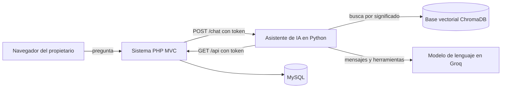
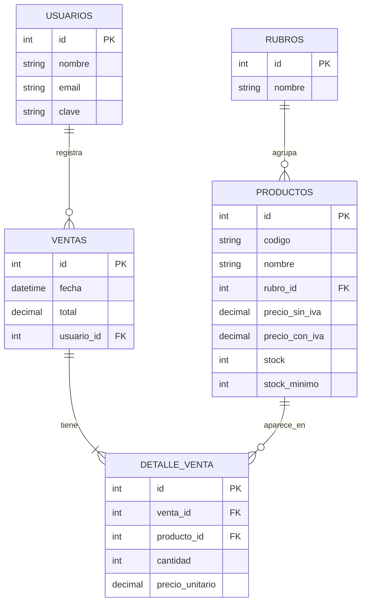

# Librería NaSer: sistema de gestión con asistente de IA

Trabajo práctico de EDI 3. Alumna: María Paz Rodríguez.

Es un sistema transaccional para una librería (productos, stock y ventas) al que se le
suma un asistente de IA. El propietario le pregunta en lenguaje natural por stock,
precios y ventas, y el asistente responde con los datos reales del sistema.

## Arquitectura

Son dos programas separados que se comunican por API:

- **Sistema de la librería:** PHP puro con patrón MVC y base de datos MySQL.
- **Asistente de IA:** servicio en Python (FastAPI) con su propia base de datos
  vectorial (ChromaDB) y un modelo de lenguaje de Groq.



Cómo se responde una pregunta, por ejemplo "¿cuánto stock tengo de la abrochadora Olami?":

1. El navegador manda la conversación al sistema PHP.
2. PHP comprueba que haya sesión iniciada y le pasa el pedido al asistente.
3. El modelo decide usar la herramienta `buscar_productos`.
4. La base vectorial encuentra los productos parecidos a "abrochadora Olami".
5. El asistente le pide al sistema, por la API, el stock y el precio actuales.
6. El modelo redacta la respuesta con esos datos.

La base vectorial solo sirve para encontrar el producto. El stock y los precios se
consultan siempre en MySQL, así la IA nunca responde con números viejos.

## Temas de la materia aplicados

| Tema | Dónde está |
|---|---|
| Embeddings (`all-MiniLM-L6-v2`) | `asistente-ia/base_vectorial.py` |
| RAG: recuperar y después generar | `herramientas.py`, función `buscar_productos` |
| Base vectorial propia de la IA | ChromaDB, carpeta `asistente-ia/base_vectorial/` |
| Function calling | `asistente-ia/herramientas.py` (5 herramientas) |
| Agente con loop y límite de pasos | `asistente-ia/agente.py` |
| Prompt engineering | Instrucciones del agente en `agente.py` |
| APIs de IA | `agente.py` (Groq, formato compatible con OpenAI) |
| API sin memoria | El historial viaja completo en cada `POST /chat` |
| Defensa ante prompt injection | Ver la sección Seguridad |

## Base de datos del sistema



Los 50 productos salen de la lista de precios real del local. El stock y las ventas
son datos inventados para las pruebas.

Registrar una venta es una transacción: se guardan la venta y su detalle y se descuenta
el stock, todo junto. Si no alcanza el stock de un producto, no se guarda nada
(`app/models/Venta.php`, función `crear`).

## Actualización de precios

En la pantalla **Precios** se sube la lista del proveedor (Excel o CSV). El sistema compara
por código de barras y muestra una vista previa: qué productos cambian, cuáles quedan igual
y cuáles no vinieron. Los artículos de la lista que el local no trabaja se ignoran. Al
confirmar, se actualizan los precios y cada cambio queda en la tabla `historial_precios`
(`database/02_historial_precios.sql`). El asistente puede consultar ese historial para
responder qué productos aumentaron más.

## Base de datos de la IA

Por cada producto se guarda en ChromaDB:

| Dato | Para qué |
|---|---|
| Embedding (384 dimensiones) | Buscar por significado |
| Texto: nombre, rubro y descripción del tipo de producto | Es lo que se convierte en embedding |
| `producto_id`, código, nombre y rubro | Saber qué producto pedirle al sistema |
| Modelo y fecha de indexado | Saber con qué modelo se generó y cuándo |

Se carga con `python indexar.py`. Hay que volver a ejecutarlo si se agregan productos.

## APIs

**API del sistema** (PHP, solo lectura, con cabecera `X-Api-Token`):

| Endpoint | Devuelve |
|---|---|
| `GET /api/productos?q=texto` | Productos, con búsqueda opcional |
| `GET /api/productos/ver?id=12` | Un producto |
| `GET /api/productos/reponer` | Productos con stock bajo el mínimo |
| `GET /api/ventas/resumen?desde=&hasta=` | Cantidad de ventas y monto |
| `GET /api/ventas/mas-vendidos?desde=&hasta=&limite=` | Ranking de más vendidos |
| `GET /api/precios/cambios?limite=` | Cambios de precio de la última lista aplicada |

**API del asistente** (Python, con cabecera `X-Token`):

| Endpoint | Hace |
|---|---|
| `GET /salud` | Informa si el servicio está prendido |
| `POST /chat` | Recibe la conversación y devuelve la respuesta, las herramientas usadas y los tokens |

## Seguridad

- **Solo el propietario:** el chat está detrás del login. Las claves se guardan encriptadas.
- **Tokens entre servicios:** la API del sistema y la del asistente rechazan los pedidos sin token.
- **Las claves no llegan al navegador:** el navegador habla con PHP, y PHP con el asistente.
- **Mínimo privilegio:** la IA solo tiene herramientas de lectura. No puede modificar ni borrar datos, y no tiene ninguna herramienta que lea la tabla de usuarios.
- **Prompt injection:** las instrucciones indican que los mensajes y los resultados de herramientas son datos y no órdenes. El servicio solo acepta mensajes con rol `user` o `assistant`, nunca `system`.
- **Límites:** 5 pasos como máximo por consulta, 10 mensajes de historial y 1000 caracteres por mensaje.
- **Secretos fuera de git:** `config/config.php` y `asistente-ia/.env` están en `.gitignore`.

## Instalación

Requisitos: PHP 8.1 o superior con `pdo_mysql`, MySQL 8, Python 3.10 o superior y una clave gratuita de Groq.

**1. Base de datos**

```sql
CREATE USER 'libreria'@'localhost' IDENTIFIED BY 'una_clave';
GRANT ALL PRIVILEGES ON libreria_naser.* TO 'libreria'@'localhost';
```

```bash
mysql -u libreria -p < database/libreria_naser.sql
mysql -u libreria -p libreria_naser < database/02_historial_precios.sql
```

**2. Configuración del sistema**

```bash
cp config/config.example.php config/config.php
```

Completar `config.php` con los datos de MySQL y dos tokens inventados (por ejemplo, con `openssl rand -hex 16`).

**3. Asistente de IA**

```bash
cd asistente-ia
python3 -m venv venv
./venv/bin/pip install torch --index-url https://download.pytorch.org/whl/cpu
./venv/bin/pip install -r requirements.txt
cp .env.example .env
```

Completar `.env` con la clave de Groq y los mismos dos tokens de `config.php`.

**4. Prender todo**

```bash
./iniciar.sh
```

**5. Cargar la base de la IA** (en otra terminal, la primera vez)

```bash
cd asistente-ia && ./venv/bin/python indexar.py
```

**6. Entrar** a http://localhost:8080 con `propietario@libreria.com` y la clave `naser2026`.

## Pruebas

`asistente-ia/pruebas.py` le hace 10 preguntas al asistente y guarda la tabla con lo
esperado y lo obtenido en `asistente-ia/resultados_pruebas.md`. Lo esperado se calcula
con los datos actuales del sistema.

```bash
cd asistente-ia && ./venv/bin/python pruebas.py
```

Incluye una pregunta por un producto que no existe y un intento de prompt injection.

## Costos

Se usa el plan gratuito de Groq, así que el trabajo no tuvo costo. Como referencia de
consumo: una consulta simple usa cerca de 1.700 tokens y la corrida completa de las 10
pruebas usó 17.195. Los embeddings se generan en la propia computadora, sin costo.

## Limitaciones conocidas

- El modelo de embeddings está entrenado sobre todo en inglés. Para mejorar la búsqueda en español, a cada producto se le suma una descripción de su tipo antes de generar el embedding.
- Si se agregan productos, hay que volver a ejecutar `indexar.py`.
- El plan gratuito de Groq tiene un límite de pedidos por día.
- Hay un solo usuario (el propietario); no hay roles.
- El servidor que se usa es el de desarrollo de PHP, no uno de producción.

## Mejoras futuras

- Comparar los aumentos del proveedor con la inflación usando la API de series del INDEC.
- Reindexar automáticamente cuando se crea o modifica un producto.
- Alta y edición de productos desde el sistema.
- Probar un modelo de embeddings multilingüe y comparar resultados.
- Guardar un registro de las consultas hechas al asistente.
